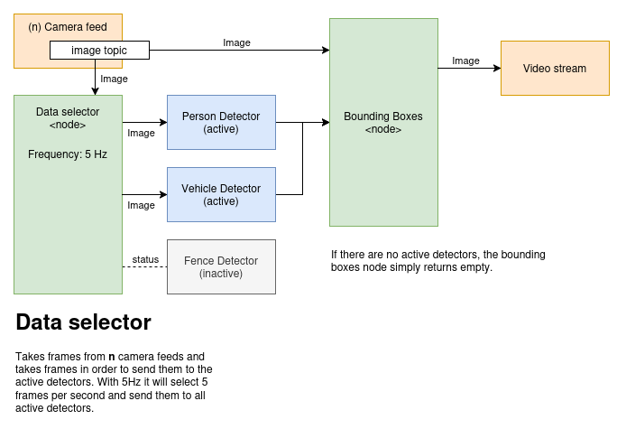

# detector_camera_mediator

ROS 1 node that subscribes to configured `sensor_msgs/Image` camera topics,
queues frames per camera, and processes them round-robin. Old queued frames are
dropped when a camera queue is full. Each frame is published to every configured
detector whose state is READY; each detector has its own image input topic.
The mediator copies each `sensor_msgs/Image`, keeps its timestamp, and writes
the resolved source camera topic to `header.frame_id` before forwarding. The
original camera message is unchanged.



## Configure

Edit `config/detector_camera_mediator.yaml` to set the image inputs, queue
capacity, and detector routing registry. These are all read by the node; no
unused keys were found. The current configuration is:

```yaml
camera_topics:
  - /robot/front_rgbd_camera/color/image_raw
  - /robot/top_ptz_camera/color/image_raw
  - /robot/top_ptz_camera/thermal/image_raw

frame_queue_size: 2

detector_registry:
  - name: person_detector
    state_topic: /robot/detectors/person_detector/state
    image_topic: /robot/detectors/person_detector/image
  - name: broken_fence_detector
    state_topic: /robot/detectors/broken_fence_detector/state
    image_topic: /robot/detectors/broken_fence_detector/image
  - name: vehicle_detector
    state_topic: /robot/detectors/vehicle_detector/state
    image_topic: /robot/detectors/vehicle_detector/image

model_status_timeout: 5.0
```

`camera_topics` order is the round-robin processing order. `frame_queue_size`
is the maximum number of pending images per camera, with the oldest dropped
when full. Each registry entry must have a unique detector `name`, its
`robotnik_msgs/State` `state_topic`, and dedicated `image_topic`. A detector
receives frames while it reports `READY_STATE` (300); READY expires if no state
update arrives before `model_status_timeout`.

Detectors need no camera-specific configuration. They receive ordinary images
on one input topic and publish bounding boxes on one output topic. The bbox
array header retains the mediator's source-topic `frame_id` and original image
timestamp for the annotator.

When launched through `inspection_bringup`, the node loads
`inspection_bringup/config/utils/detector_camera_mediator.yaml` instead of this
package's copy. Keep the two files aligned when changing the shared routing
configuration.

## Build and run

From the root of a ROS 1 catkin workspace containing this package:

```bash
catkin_make
source devel/setup.bash
roslaunch detector_camera_mediator detector_camera_mediator.launch
```

The node does not start or stop models.

Model memory is managed by the `object_detection` detector controllers, through
their existing `activate_detector` services (directly or through the detector
manager). Activation loads the configured model in a child process;
deactivation stops and joins that process while leaving the ROS controller
available for later reactivation. A detector reports READY only after loading
and subscribing to its image input. The mediator's READY tracking remains an
image-routing decision, not a model lifecycle trigger.
