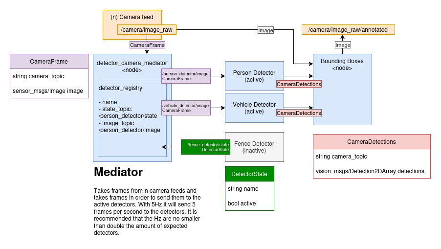

# detector_camera_mediator

ROS node that routes camera images to READY detectors. It queues frames per
camera, drops the oldest when a queue is full, and dispatches round-robin at a
configurable total rate (10 Hz by default, at most one frame per tick).
Each detector receives an `object_detection_msgs/CameraFrame` with the resolved
source topic in `camera_topic` and the original image in `image`. Status is
published as JSON every five seconds on `/detector_camera_mediator/status`.



## Related packages

- [object_detection](https://github.com/RobotnikAutomation/object_detection)

## Configure

Edit `config/detector_camera_mediator.yaml` to configure cameras, queue size,
dispatch rate, and detector topics:

```yaml
# Camera topics are processed in the order listed.
camera_topics: [
  "/robot/front_rgbd_camera/color/image_raw",
  "/robot/top_ptz_camera/color/image_raw",
  "/robot/top_ptz_camera/thermal/image_raw"
]

# Maximum number of pending frames to retain per camera; oldest frames are dropped first.
frame_queue_size: 2

# Maximum work dispatches per second across all cameras.
processing_rate_hz: 10.0

# A detector receives frames on its image_topic only while its state is READY.
detector_registry:
  - name: person_detector
    state_topic: "/robot/detectors/person_detector/state"
    image_topic: "/robot/detectors/person_detector/image"
  - name: broken_fence_detector
    state_topic: "/robot/detectors/broken_fence_detector/state"
    image_topic: "/robot/detectors/broken_fence_detector/image"
  - name: vehicle_detector
    state_topic: "/robot/detectors/vehicle_detector/state"
    image_topic: "/robot/detectors/vehicle_detector/image"
  - name: multiclass_detector
    state_topic: "/robot/detectors/multiclass_detector/state"
    image_topic: "/robot/detectors/multiclass_detector/image_raw"
  - name: fire_detector
    state_topic: "/robot/detectors/fire_detector/state"
    image_topic: "/robot/detectors/fire_detector/image_raw"

# READY is considered stale if no state update arrives within this interval.
model_status_timeout: 5.0
```

Camera order determines round-robin order. Each detector entry requires a
unique `name`, a `robotnik_msgs/State` `state_topic`, and an `image_topic`.
Frames are routed while its state is `READY_STATE` (300); READY expires after
`model_status_timeout` without an update.

Detectors publish `object_detection_msgs/CameraDetections` on
`camera_detections` for the annotator. The standard `bounding_boxes` output
remains a `vision_msgs/Detection2DArray`.

`inspection_bringup` uses
`inspection_bringup/config/ai_perception/detector_camera_mediator.yaml` instead
of this package's config. Keep both files aligned.

## Build and run

From a ROS catkin workspace:

```bash
catkin_make
source devel/setup.bash
roslaunch detector_camera_mediator detector_camera_mediator.launch
```

The mediator only routes images; it does not manage model lifecycle. The
`object_detection` controllers manage models through their `activate_detector`
services and report READY after loading and subscribing to the image input.
